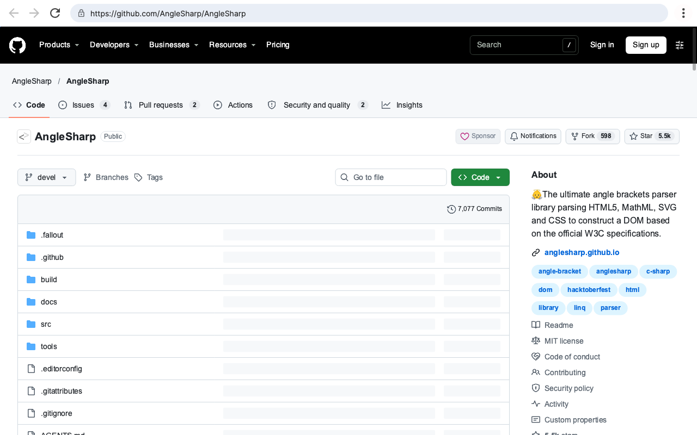
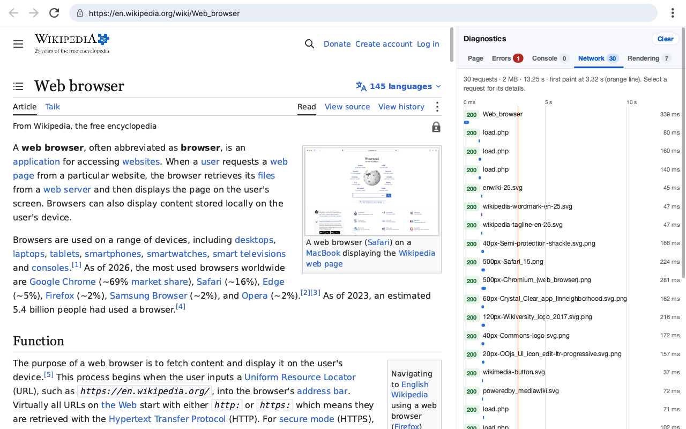
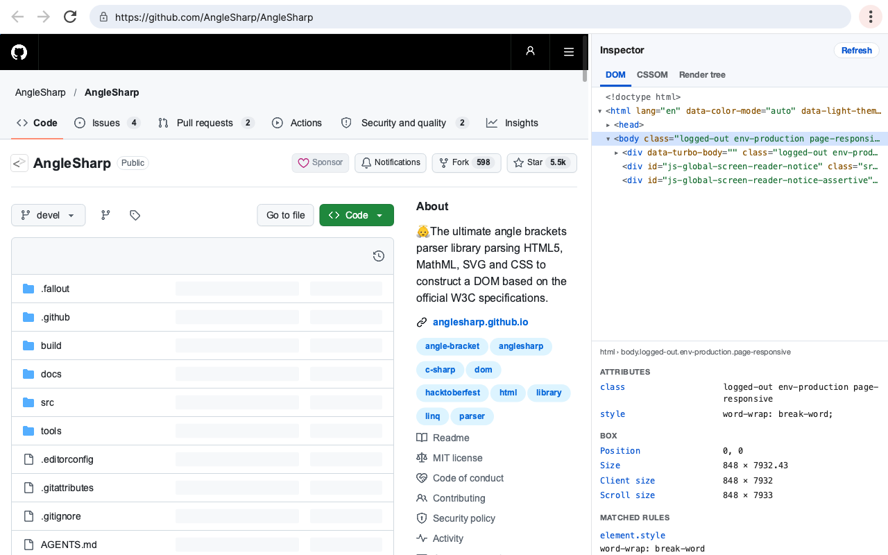
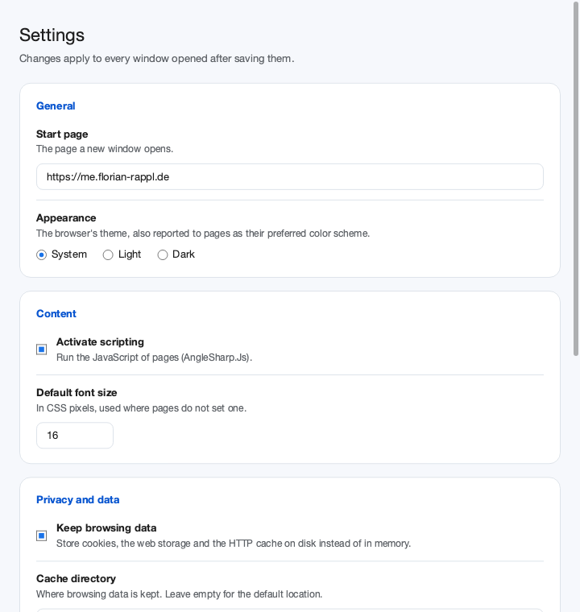
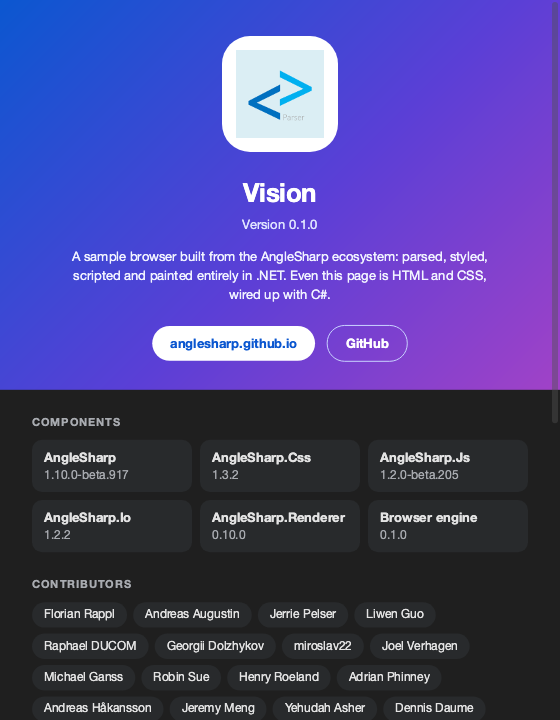

# AngleSharp.Browser

[](https://github.com/AngleSharp/AngleSharp.Browser/actions/workflows/ci.yml)
[](https://github.com/AngleSharp/AngleSharp.Browser/releases)
[](https://www.nuget.org/packages/AngleSharp.Browser/)
[](https://github.com/AngleSharp/AngleSharp.Browser/issues)
[](https://cla-assistant.io/AngleSharp/AngleSharp.Browser)

AngleSharp.Browser brings everything from the AngleSharp ecosystem together in a set of packages that can either be a rendering (visible) browser; in form of a re-usable component.



## Packages

| Package | Description |
| --- | --- |
| [AngleSharp.Browser](https://www.nuget.org/packages/AngleSharp.Browser/) | A UI-agnostic `BrowserEngine` wiring up AngleSharp, AngleSharp.Css, AngleSharp.Js, AngleSharp.Io and AngleSharp.Renderer. It navigates (with back / forward history), paints the current document and translates pointer, wheel and keyboard input into DOM interactions (hover, links, forms, focus, text entry, scrolling). |
| [AngleSharp.Browser.Avalonia](https://www.nuget.org/packages/AngleSharp.Browser.Avalonia/) | A ready to use `BrowserView` control for showing web pages in Avalonia applications. |

The repository also contains **Vision**, a sample browser showing how the packages are used.

Rendering quality and speed are bound by AngleSharp.Renderer, which is still an early layout engine.

## Quick Start

### In an Avalonia Application

```sh
dotnet add package AngleSharp.Browser.Avalonia
```

```xml
<Window xmlns="https://github.com/avaloniaui"
        xmlns:browser="using:AngleSharp.Browser.Avalonia">
    <browser:BrowserView Source="https://example.org" />
</Window>
```

### Without Any UI

```sh
dotnet add package AngleSharp.Browser
```

```cs
using var engine = new BrowserEngine(new BrowserOptions
{
    ProfileDirectory = null, // keep everything in memory
    ViewportWidth = 1280,
    ViewportHeight = 800,
});

await engine.NavigateAsync("https://example.org");
await engine.ClickAsync(40, 390);
var image = await engine.PaintAsync();
await File.WriteAllBytesAsync("page.png", image!.Data);
```

## Documentation

The [docs](docs/README.md) cover the [engine](docs/general/02-Engine.md), [rendering](docs/general/03-Rendering.md), [input](docs/general/04-Input.md), [configuration](docs/general/05-Configuration.md), the [Avalonia control](docs/general/06-Avalonia.md), and have a collection of [examples](docs/tutorials/02-Examples.md).

## Vision

Vision is the sample browser of this repository: a proof of concept, not a product. Run it (optionally with a start address) from a clone:

```bash
dotnet run --project src/Vision -- https://example.org
```

Cookies, web storage and the HTTP cache are persisted in a profile directory (by default in the local application data folder). Use `--profile <directory>` to pick another one or `--in-memory` to persist nothing.

The diagnostics (F12) show what a page did: errors with their stack traces, the console output, a waterfall of the requests and the timings of the rendering. They are HTML and CSS rendered by a second `BrowserView`, like the rest of Vision's own UI:



The inspector (Ctrl+Shift+I) opens in the same place and shows the page as AngleSharp sees it right now: its DOM, its CSSOM and its render tree, with the matched rules, computed style and box of any element:



| Settings | About |
| --- | --- |
|  |  |

## Help Us Render the Web

Every page that looks wrong points at something we can improve, and Vision is the easiest way to find those pages. Run it with a website you care about:

```bash
dotnet run --project src/Vision -- https://your-favorite-website.example
```

If the page does not render correctly, then please do one of the following:

1. **Report it.** [Open an issue](https://github.com/AngleSharp/AngleSharp.Browser/issues/new/choose) with the address, a screenshot, and what you expected to see.
2. **Even better, fix it.** Point your coding agent at the page and let it find the cause, then send a pull request to the project responsible.

The diagnostics (F12) show the page's failed requests, errors and console output, and the inspector (Ctrl+Shift+I) shows the DOM, CSSOM and render tree AngleSharp ended up with, which is a good place to start. The fix may belong to any part of the ecosystem:

| Project | Responsible for |
| --- | --- |
| [AngleSharp](https://github.com/AngleSharp/AngleSharp) | HTML parsing and the DOM |
| [AngleSharp.Css](https://github.com/AngleSharp/AngleSharp.Css) | CSS parsing, the cascade and computed styles |
| [AngleSharp.Xml](https://github.com/AngleSharp/AngleSharp.Xml) | XML parsing and validation |
| [AngleSharp.Renderer](https://github.com/AngleSharp/AngleSharp.Renderer) | Layout and painting |
| [AngleSharp.Js](https://github.com/AngleSharp/AngleSharp.Js) | Running scripts and exposing the DOM to them |
| [AngleSharp.Io](https://github.com/AngleSharp/AngleSharp.Io) | Requests and other I/O |
| [AngleSharp.Browser](https://github.com/AngleSharp/AngleSharp.Browser) | Navigation, input, scrolling and Vision itself |

Not sure which one it is? Open the issue here and we will help to find out. A small reproduction and a test make a pull request much easier to review, whoever (or whatever) wrote it. See the [contributing guide](.github/CONTRIBUTING.md) for the details.

## .NET Foundation

This project is supported by the [.NET Foundation](https://dotnetfoundation.org).

## License

AngleSharp.Browser is released using the MIT license. For more information see the [license file](./LICENSE).
