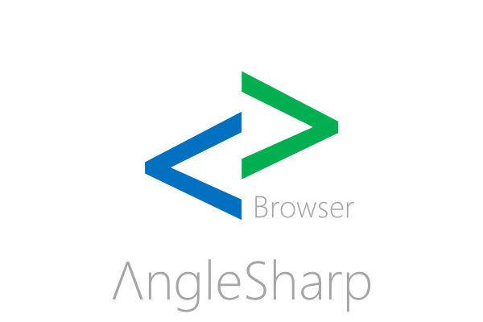

# AngleSharp.Browser

[](https://github.com/AngleSharp/AngleSharp.Browser/actions/workflows/ci.yml)
[](https://github.com/AngleSharp/AngleSharp.Browser/releases)
[](https://www.nuget.org/packages/AngleSharp.Browser/)
[](https://github.com/AngleSharp/AngleSharp.Browser/issues)
[](https://cla-assistant.io/AngleSharp/AngleSharp.Browser)

AngleSharp.Browser brings everything from the AngleSharp ecosystem together in a set of packages that can either be a rendering (visible) browser; in form of a re-usable component.

## Current Status

Proof of concept. The repository contains:

- `AngleSharp.Browser.Core`: a UI-agnostic `BrowserEngine` wiring up AngleSharp, AngleSharp.Css, AngleSharp.Js, AngleSharp.Io and AngleSharp.Renderer. It navigates (with back / forward history), paints the current document into PNG frames and translates pointer, wheel and keyboard input into DOM interactions (hover, links, forms, focus, text entry, scrolling).
- `AngleSharp.Browser`: an Avalonia desktop app hosting the engine in a reusable `BrowserView` control.

Rendering quality and speed are bound by AngleSharp.Renderer, which is still an early layout engine.

## Quick Start

Run the browser (optionally with a start address):

```bash
dotnet run --project src/AngleSharp.Browser -- https://example.org
```

Cookies, web storage and the HTTP cache are persisted in a profile directory (by default in the local application data folder). Use `--profile <directory>` to pick another one or `--in-memory` to persist nothing.

The engine can also be used without any UI:

```csharp
using var engine = new BrowserEngine(new BrowserOptions
{
    ProfileDirectory = null, // keep everything in memory
    ViewportWidth = 1280,
    ViewportHeight = 800,
});

await engine.NavigateAsync("https://example.org");
await engine.ClickAsync(40, 390);
var frame = await engine.PaintAsync();
await File.WriteAllBytesAsync("page.png", frame!.Data);
```

## .NET Foundation

This project is supported by the [.NET Foundation](https://dotnetfoundation.org).

## License

AngleSharp.Browser is released using the MIT license. For more information see the [license file](./LICENSE).
